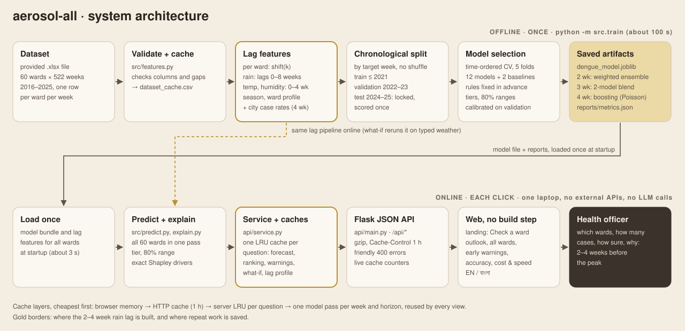

# Architecture

> ML and Phase 2 module sections by A; data flow, serving and cost by B/C.



**Offline, once** (`python -m src.train`, about 100 s): data → lag features → chronological split → model
selection → one serialized bundle plus `reports/`. **Online, per click:** the browser calls the local Flask API,
which reuses the model and lag features loaded at startup. No step calls an external service.

## Features and leakage control
A forecast is made at origin week *t* for week *t + h* (h = 2, 3, 4), using only data up to *t*.
Features are built per ward with `groupby("ward_id").shift(k)`:

- rainfall lags 0–8 weeks (the 2–4 week breeding window; above-normal rain is followed by above-normal cases
  3 weeks later, r = 0.47 in every city, `/api/lag_profile`);
- temperature and humidity lags, season, ward water-logging, density and sanitation;
- 4-week model only: city-wide reported cases per ward (this week, last week, 4- and 8-week means, 3-week change).

Tests prove no feature changes when future rows are removed. The Phase 2 file adds three supply columns; they are
same-week functions of cases, so `feature_columns()` refuses them and a test shows features and predictions are
identical with either data file.

## Chronological validation split
| Set | Target weeks | Purpose |
|---|---|---|
| Train | 2016–2021 | fitting; **time-ordered CV** (5 expanding yearly folds) chooses settings and features |
| Validation | 2022–2023 | confirming the choice; calibrating tiers and 80% intervals |
| Test | 2024–2025 | reported once, never used for any choice; rows hash-locked (`reports/test_set_lock.json`) |

## Model selection
12 models on identical folds (`reports/model_comparison.json`), Poisson deviance, CV mean (validation):

| | h=2 | h=3 | h=4 |
|---|---|---|---|
| Best baseline (seasonal mean / Ridge) | 1.91 (1.74) | 1.98 (1.96) | 1.98 (1.96) |
| HistGradientBoosting, Poisson loss | 0.96 (1.03) | 1.14 (1.20) | 1.31 (1.70) |
| **Deployed** | **0.95 (0.97)** | **1.09 (1.11)** | **1.24 (1.57)** |

Deployed, under rules fixed in advance (`reports/tuning_log.json`, `reports/ensemble.json`): a weighted ensemble at
2 weeks, a boosting + extra-trees average at 3 weeks, regularised boosting plus the city case rates at 4 weeks.

**Test (2024–25):** MAE 1.12 / 1.12 / 1.24 (seasonal baseline 1.26). Truly Critical weeks flagged High or above:
88% / 78% / 67%. Outbreak weeks are under-predicted by 6–8 cases (`reports/outbreak_errors.json`).
**2–3 weeks is the dependable window.** Tiers: 2 / 9 / 15+ cases; intervals: conformal per season (Jul–Oct
coverage 0.77–0.78); drivers: exact grouped Shapley values (`reports/explainability.json`).

## Serving, compute and API cost efficiency
No LLMs or external APIs (`scripts/measure_efficiency.py` blocks the network and counts 0 calls). The model loads
once; `predict_all` scores all 60 wards in one pass, reused by every view behind four caches (browser, HTTP
`max-age=3600`, server LRU, shared pass). JSON over 1 KB is gzipped.

`reports/efficiency.json` (MacBook, Apple silicon, Python 3.9.6, medians of 50 calls):

| Measure | Value |
|---|---|
| Model file / startup to app ready | 11.4 MB / 2.7 s |
| One-ward forecast uncached / cached | 0.76 s / 0.0006 s |
| What-if, new / repeated | 0.53 s / 0.016 s |
| Full retrain, 3 horizons | 100 s |
| External API calls / LLM calls | 0 / 0 |

## Phase 2: from forecast to action
Everything below runs in the same Python process, offline, with no network or LLM call.

```text
 predict_all(as_of, h)        src/predict.py   60 wards: predicted_cases, range_high, risk_tier
        |
        v
 supplies_for(cases)          src/supplies.py  cases -> saline, kits, beds (learned from the data)
        |
        +--> allocate / plan      src/allocation.py    stock 30-100%, crews  -> per-ward fill, deficits, crews
        +--> overflow_plan        src/overflow.py      bed capacity, beds %  -> intra-city transfers, unroutable
        +--> simulate / roi_ranking  src/intervention.py  crews -> lower water-logging -> re-run models h=2,3,4
        |
        v
 dispatch notices (in progress) -> /api/* (in progress) -> web UI (in progress)
 all settings: config/operations.json            no network, no LLM, deterministic
```

### Supplies (`src/supplies.py`)
Each supply column is a fixed function of `dengue_cases`. The module keeps the exact table for the 38 counts seen
(0–41) and, for unseen counts, a fitted ratio (2.386 saline, 1.162 kits, 0.298 beds per case), rounded half up; it
reproduces all 31,320 rows. Forecasts are rounded half up to whole patients first.

### Allocation (`src/allocation.py`)
**Rule:** priority = tier weight (Low 1 … Critical 4) × `population_density_sqkm`, ties by `ward_id`. Wards are
filled greedily in that order, each to 100%, until an item runs out; any ward below 100% on any item is `critical`.
Crews go one at a time to the ward with the highest (priority × cases) / (crews there + 1), at most 3 per ward.
**Why:** the brief asks for high-risk, dense wards first; greedy order puts shortage only on the lowest-priority
wards; the divisor spreads crews. 100% stock = this week's total forecast need. Example (2025-07-14, 3 weeks, 50% stock, 20 crews): 654 of 1,309 saline bags,
82 of 165 beds allocated; 23 wards fully served, 37 critical; 20 crews placed.

### Overflow routing (`src/overflow.py`)
**Rule:** beds needed come from the supply lookup. Capacity = each ward's 95th-percentile weekly beds in
2016–2021, rounded up, at least 2 (2–6 beds per ward, 223 in total). Patients move only within their city; the
largest overflow is helped first, each patient goes to the ward with the most free beds, and what cannot be placed
is reported as unroutable. `beds_available_pct` (30–100%) sets the share of beds free for dengue (beds are shared
with other patients). **Why:** the brief requires intra-city routing; training years only avoid leakage. Over 78 weeks (2024-06-03 to 2025-11-24, 2 weeks ahead) a transfer happens in 1 week at 100%
beds, 13 at 70%, 4 at 50%. Demo week: 2025-09-15 at 70%, 5 patients moved, none stranded.

### Vector-control simulator (`src/intervention.py`)
**Rule:** each crew lowers the ward's `water_logging_risk_index` by 15% (cap 50%), never below the training-years
minimum (0.22, read from the data; `floor_hit` is reported); the deployed models are re-run at 2, 3 and 4 weeks.
**ROI** = cases prevented over weeks +2 to +4 per crew; beds and saline follow from the supply lookup.
**Why water-logging:** the 2- and 3-week models use no case history, so lowering past cases would change nothing;
all three models use water-logging, which larvicide crews remove; on two 2025 peak weeks (14 July, 1 September), cutting it by 15/30/50% lowered or kept 1,077 of 1,080 ward forecasts; 3 rose by 0.01 cases, one rounding step.
**Why the floor:** below values the models saw, trees repeat their edge value. Crews change only their own ward,
so `roi_ranking()` scores all 60 wards in one run per horizon (under 0.2 s). Example (2025-07-14): best ward DSCC_Ward_12 saves 5.6 cases per crew (3.5 with 2
crews: diminishing returns); 2 crews in each of the top 5 wards cut the 2-week forecast from 564.3 to 552.4 cases,
5 beds and 30 saline bags. Off-season (2025-02-03) no ward saves more than 0.01 cases.

### Determinism
Every entry point gives identical output when repeated or when input rows are shuffled (`tests/test_determinism.py`).

### Assumptions (`config/operations.json`, condensed; the file holds the full reason for each)
| Setting | Value | Kind | Why |
|---|---|---|---|
| `demand.basis` | predicted cases (or `range_high`) | assumption | plan for the central forecast; the top of the 80% range is the cautious option |
| `demand.rounding` | half up | assumption | supplies are bought for whole patients |
| `stock.full_stock_basis` | forecast total demand | assumption | no warehouse counts in the data, so 100% = this week's total need |
| `stock.full_stock_units` | none | assumption | fixed warehouse units per item, once known |
| `stock.stock_pct_range` | 30–100% | assumption | the scarcity slider required by the brief |
| `priority.tier_weight` | 1 / 2 / 3 / 4 | assumption | high-risk wards first, in equal steps |
| `priority.tie_break` | ward_id | assumption | same inputs, same allocation |
| `priority.fill_rule` | greedy by priority | assumption | shortage lands on the lowest-priority wards |
| `crews.total_default` | 20 | assumption | no crew numbers in the data; about one per three wards |
| `crews.max_per_ward` | 3 | assumption | more crews mostly overlap the same streets |
| `crews.min_predicted_cases` | 1.0 | assumption | crews go where transmission is expected |
| `crews.assignment_rule` | highest share | assumption | a second crew in a ward counts half as much |
| `crew_effect.model_input` | water_logging_risk_index | assumption | the one crew-changeable input all three models use |
| `crew_effect.reduction_per_crew` | 0.15 | assumption | no intervention data; officers can change it |
| `crew_effect.max_total_reduction` | 0.5 | assumption | crews cannot remove all breeding sites |
| `bed_capacity.rule` | 95% quantile to 2021, round up, min 2 | **data rule** | no capacity in the data; over capacity only in a ward's worst ~5% of weeks |
| `bed_capacity.beds_available_pct` | 100 | assumption | beds are shared with non-dengue patients |
| `overflow.same_city_only` | true | assumption | required by the brief |
| `overflow.sender_order` | largest overflow first | assumption | the biggest gaps are helped first |
| `overflow.receiver_order` | most free beds first | assumption | "lower burden" read as most spare room; fewer transfers |

### Limits
- **The crew effect is not causal.** `water_logging_risk_index` is fixed per ward, so the models learned its link
  to cases across wards, not over time. The simulator shows what the model expects for a less water-logged ward;
  the 15% per crew is an assumption.
- **When a whole city is over capacity, routing cannot help.** Dengue peaks hit every ward of a city in the same
  weeks: on 2025-07-14 at 50% beds, 58 of 60 wards are over capacity and none has a free bed, so all overflow is
  reported as unroutable (cities at 153–186% use). Routing helps only when neighbours still have room.
- **Supplies are a fixed function of cases**, with no severity or age effect, and inherit forecast error: outbreak
  weeks are under-predicted by 6–8 cases, so surges are understated (`range_high` is the cautious option).
- **Bed capacity and stock are rules, not counts.** Real hospital and warehouse numbers would replace them in the config.

### In progress (not on `main` yet)
| Item | Owner |
|---|---|
| `POST /api/allocate`, `GET /api/overflow`, `POST /api/intervention` (R4, O3, V3) | B |
| `src/dispatch.py` notices (SMS, WhatsApp, HTML brief, EN + বাংলা) and `exports/` samples (D1, D2) | B |
| `scripts/offline_check.py` kill-switch test (F2), live URL (G1) | B |
| Allocation, overflow, simulator and dispatch views (R5, O4, V4, D3) | C |

### Reproducing the Phase 2 numbers
Every Phase 2 number above is printed by `python -m scripts.phase2_numbers` (read-only, about a minute). Timings
vary by machine; Phase 1 numbers come from the `reports/*.json` files named next to them.
