# Architecture

> Sections below cover the weather lag pipeline, the chronological validation split and
> the model selection rationale. Teammates: add the data flow diagram, UI and cost sections.

## System data flow

```mermaid
flowchart LR
  A["hackathon_preli_dataset.xlsx<br/>60 wards × 522 weeks"] --> B["validate() + CSV cache<br/>src/features.py"]
  B --> C["Lag features per ward_id<br/>rain lags 0–8 wk, temp/humidity 0–4 wk,<br/>rolling rain sums, season, ward profile"]
  C --> D["Chronological split by target week<br/>train ≤2021 · val 2022–23 · test 2024–25"]
  D --> E["HistGradientBoosting (Poisson)<br/>one model per horizon: 2, 3, 4 weeks"]
  E --> F["models/dengue_model.joblib<br/>+ tier cut points + 80% conformal band"]
  E --> G["reports/metrics.json<br/>test_predictions_h*.csv"]
  F --> H["src/predict.py<br/>predict_all / predict_risk + drivers"]
  C --> H
  H --> I["api/service.py<br/>JSON views, LRU-cached"]
  G --> I
  I --> J["api/main.py (Flask)<br/>/api/forecast · /api/ranking · /api/metrics<br/>gzip + Cache-Control"]
  J --> K["web/ (HTML/CSS/JS)<br/>marketing page · dashboard"]
  K --> L["Public health officer<br/>tier, likely range, drivers,<br/>ward ranking, accuracy"]
```

Offline (once): data → features → training → serialized model and metrics. Online (per click):
the browser calls the local API, which reuses the loaded model and cached features. No step calls
an external service.

## Lag pipeline (`src/features.py`)

Each prediction is made at a **forecast origin** week *t* for week *t + h*, where h ∈ {2, 3, 4} weeks.
Features may only use data from weeks ≤ *t*. All lags are computed in code from the raw file with
`groupby("ward_id").shift(k)`, so one ward's history never bleeds into another's.

- `validate()` checks the assumptions the lag logic depends on and stops if any fail:
  every required column is present, no missing values, no duplicate ward/date rows, every gap is
  exactly 7 days (so `shift(k)` means *k weeks*), and ward attributes are constant per ward.
- Features (34): rainfall lags 0–8 weeks; temperature and humidity lags 0–4 weeks; rolling rain sums
  over weeks 0–1, 2–4, 0–3 and 0–8; 4-week mean temperature and humidity; week-of-year sin/cos;
  and the static ward attributes `water_logging_risk_index`, `population_density_sqkm` and
  `sanitation_score`.
- **The data supports the lag choice.** After removing ward × week-of-year seasonality, case
  counts correlate with rain at a lag of 2 weeks (r = 0.23), 3 weeks (r = 0.47, the peak) and
  4 weeks (r = 0.33), and at roughly 0 beyond 5 weeks. Average cases per ward correlate with
  water-logging risk (r = 0.82), population density (0.57) and sanitation score (−0.40).
- `tests/test_features.py` checks that the lags are exact and per-ward, that truncating the data
  at a cutoff date leaves earlier features unchanged (no future data), and that the target is
  the same ward's cases *h* weeks later.

## Chronological validation split

The split is by **target week**, never random. Random splits leak, because neighbouring weeks
share weather and seasonal state.

| Set | Target weeks | Rows (h=2) | Used for |
|---|---|---|---|
| Train | 2016-01 → 2021-12 | 18,180 | fitting candidate models |
| Validation | 2022-01 → 2023-12 | 6,240 | model selection, risk-tier calibration, interval calibration |
| Test | 2024-01 → 2025-12 | 6,300 | reported once; never used for tuning |

The model that ships is refit on train + validation with the hyperparameters chosen above.
Test numbers come from the train-only model, so they are an honest out-of-sample estimate.

## Model selection rationale (`src/train.py`)

The target is a weekly count with many zeros (58%) and a strong seasonal peak (Jul–Oct), so
candidates were compared on **Poisson deviance** on the validation set:

| Validation Poisson deviance | h=2 | h=3 | h=4 |
|---|---|---|---|
| Seasonal naive (ward × week-of-year mean) | 1.96 | 1.96 | 1.96 |
| Poisson GLM (log-features) | 1.26 | 1.51 | 2.04 |
| **HistGradientBoosting, Poisson loss** | **1.09** | **1.30** | **1.80** |

Gradient boosting with Poisson loss was chosen because it:

- handles a count target without negative predictions;
- captures the interaction the brief describes, where the same rain is far worse in a ward with
  high water-logging risk and poor sanitation, without hand-built interaction terms;
- runs on scikit-learn alone, trains in about 10 seconds and predicts all 60 wards in about 40 ms.

There is one model per horizon. All of them are serialized together in `models/dengue_model.joblib`.

**Test results (2024–2025):**

| | h=2 | h=3 | h=4 |
|---|---|---|---|
| MAE (seasonal naive MAE: 1.26) | 1.06 | 1.07 | 1.27 |
| RMSE | 2.16 | 2.16 | 2.56 |
| Truly Critical weeks flagged High or Critical | 87% | 83% | 62% |
| Tier within one level | 98% | 98% | 97% |
| 80% interval coverage, all weeks / Jul–Oct | 0.79 / 0.75 | 0.79 / 0.74 | 0.80 / 0.73 |

At 4 weeks ahead the model is no better than the seasonal baseline. This is expected from the
physics: the strongest driver, rain 3 weeks before the target week, falls *after* the forecast
origin, so the model mostly has seasonality to work with. The 2–3 week forecasts are the
dependable early-warning window.

### Risk tiers

The tiers are defined in actual cases per ward-week, using quantiles of the training data:
Medium ≥ p70 (2 cases), High ≥ p90 (9), Critical ≥ p97 (15). Predicted means are shrunk toward
the centre, so applying those cut points to predictions directly caught only 6 of 111 Critical
weeks. Instead, the prediction cut points are set on the validation set by quantile matching,
so that each tier is predicted about as often as it actually occurs. This raised the share of
Critical weeks flagged High or above from 65% to 87% at h=2. The cost is more false alarms,
which is the right trade for an early-warning system.

### Confidence intervals

The intervals are 80% split-conformal intervals. They are asymmetric and scaled by
√(prediction + 1), because count noise grows with the mean. They are calibrated separately
for each predicted-value bin (<1, 1–5, ≥5 cases). Two earlier versions were rejected:

- **Quantile gradient boosting** stopped training early, and its lower bound was about 0 even
  at the season peak.
- **A single global calibration** gave 80% coverage overall but only 56% in Jul–Oct, because
  near-zero off-season weeks dominated it.

Calibrating per bin raised Jul–Oct coverage to about 0.75. The remaining gap is consistent with
2024–25 being lower-incidence years than the calibration years.

## Serving, compute and API cost efficiency

- **No LLMs and no external APIs.** Inference runs locally from the serialized model, so there are no
  per-request fees, token costs or rate limits. `scripts/measure_efficiency.py` blocks outbound network
  while it exercises every endpoint and records `external_network_calls` in `reports/efficiency.json`.
- **Serialized model, loaded once.** `models/dengue_model.joblib` holds all three horizon models and is
  loaded at startup (`load_bundle()`, cached). Lag features for all wards are built once and reused.
- **Response caching.** Each API response depends only on its query, so `forecast` and `ranking` are
  memoised with bounded LRU caches. The responses carry `Cache-Control: max-age=3600`, so browsers and any
  CDN can reuse them.
- **Vectorised inference.** One `predict_all` call scores all 60 wards in a single model pass. The
  driver breakdown adds one pass per feature group, not one per ward.
- **Small payloads.** JSON responses over 1 KB are gzip-compressed.
- **Minimal dependencies.** Python only (scikit-learn, pandas, Flask). There's no Node build or GPU,
  and it runs on a basic office laptop.

Measured with `python -m scripts.measure_efficiency --train` (copy the values from `reports/efficiency.json`):

| Measure | Value |
|---|---|
| Model file size | TBD |
| Model load at startup | TBD |
| Lag features for all 60 wards | TBD |
| Ranking of 60 wards, first request / cached | TBD / TBD |
| One-ward forecast, cached | TBD |
| Ranking payload, raw / gzip | TBD / TBD |
| Full retrain, 3 horizons | TBD |
| External network calls during the run | TBD |

## Path to a live system (Phase 2)

The split into model → `api/service.py` → `api/main.py` → `web/` keeps each layer replaceable:

- **Live data.** Append new weekly weather and case rows, re-run `validate()` and refresh the caches. The
  lag pipeline and API contract don't change.
- **Scale out.** The API is stateless, so several workers can run behind a load balancer (for example
  gunicorn), with the static `web/` folder on a CDN.
- **Retraining.** `python -m src.train` rebuilds every artifact in seconds. Metrics are versioned next to
  the model in `reports/`.

