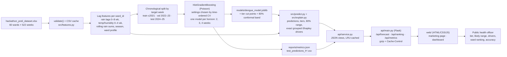

# Architecture

> ML sections (features, split, model selection) by A; data flow, serving, cost and Phase 2 by B/C.

## System data flow

Offline (once): data → features → training → serialized model and metrics. Online (per click):
the browser calls the local API, which reuses the loaded model and cached features. No step calls
an external service.

## Features and leakage control
Each forecast is made at origin week *t* for week *t + h*, where h = 2, 3 or 4, using only data up
to *t*. All features are computed per ward with `groupby("ward_id").shift(k)`:

- rainfall lags 0–8 weeks, including the 2–4 week breeding window (the 3-week lag correlates most
  with cases, r = 0.47);
- temperature and humidity lags;
- season (week-of-year);
- ward water-logging, density and sanitation.

Tests prove that no feature changes when future rows are removed. **Feature selection** dropped only
near-duplicates whose removal improved CV (the 4-week temperature mean, r = 0.98 with season); see
`reports/feature_selection_log.json` and `reports/feature_list.json`.

## Chronological validation split
| Set | Target weeks | Purpose |
|---|---|---|
| Train | 2016–2021 | fitting; **time-ordered CV**: 5 expanding yearly folds choose settings and features |
| Validation | 2022–2023 | confirming the choice; calibrating tiers and 80% intervals |
| Test | 2024–2025 | reported once, never used for any choice |

There is no random shuffle anywhere (sklearn's random early stopping is off).

## Model selection
12 models on identical folds (`reports/model_comparison.json`):

| Poisson deviance, CV mean (validation) | h=2 | h=3 | h=4 |
|---|---|---|---|
| Best baseline (seasonal mean / Ridge) | 1.91 (1.74) | 1.98 (1.96) | 1.98 (1.96) |
| Poisson GLM | 1.16 (1.15) | 1.38 (1.31) | 1.69 (1.88) |
| Extra trees | 1.03 (0.98) | 1.16 (1.10) | 1.44 (1.57) |
| **HistGradientBoosting, Poisson loss** | **0.96 (1.03)** | **1.14 (1.20)** | **1.31 (1.70)** |

Boosting wins on CV at every horizon, so it stays (the rule requires a more-than-2% CV win to
replace it). Extra trees does better on validation, so averaging the two is a natural next step. Recent case counts didn't help, so the model stays weather-only.

**Test (2024–25):**
- MAE 1.07 / 1.11 / 1.28, against 1.26 for the seasonal baseline.
- Truly Critical weeks flagged High or above: 85% / 83% / 68%; alert precision 0.50 (h=2).
- Outbreak weeks are under-predicted by about 6 cases (`reports/outbreak_errors.json`), which is
  why tier cut points are calibrated.

At h=4 the model matches the baseline, because the main driver (rain 3 weeks earlier) hasn't fallen
yet, so **2–3 weeks is the dependable window**. An unseen-city hold-out matches seen cities (MAE 1.00).

**Tiers:** 2 / 9 / 15 or more cases (training p70/p90/p97), calibrated on validation.
**Intervals:** conformal (coverage 0.79). **Drivers:** exact grouped Shapley values. The tier and
interval issues were first seen on test, then confirmed on validation.

## Serving, compute and API cost efficiency

- **No LLMs and no external APIs.** Inference runs locally from the serialized model, so there are no
  per-request fees, token costs or rate limits. `scripts/measure_efficiency.py` blocks outbound network
  while it exercises every endpoint and records `external_network_calls` in `reports/efficiency.json`.
- **Serialized model, loaded once.** `models/dengue_model.joblib` holds all three horizon models and is
  loaded at startup (`load_bundle()`, cached). Lag features for all wards are built once and reused.
- **Response caching.** Each API response depends only on its query, so `forecast` and `ranking` are
  memoised with bounded LRU caches. The responses carry `Cache-Control: max-age=3600`, so browsers and any
  CDN can reuse them.
- **Vectorised inference.** One `predict_all` call scores all 60 wards in a single model pass. The
  Shapley drivers need 32 batched calls for all 60 wards together, not separate calls per ward.
- **Small payloads.** JSON responses over 1 KB are gzip-compressed.
- **Minimal dependencies.** Python only (scikit-learn, pandas, Flask). There's no Node build or GPU,
  and it runs on a basic office laptop.

Measured with `python -m scripts.measure_efficiency --train` on a Windows 11 laptop (Python 3.12.10, 21 Nov 2026).
Source: `reports/efficiency.json`.

| Measure | Value |
|---|---|
| Model file size (3 horizon models) | 0.56 MB |
| Model load at startup | 0.37 s |
| Lag features for all 60 wards × 522 weeks (once at startup) | 4.5 s |
| App startup, including pre-computing the default week | 10.0 s |
| Forecast for a new week (3 horizons, with drivers), first request | 0.88 s |
| Ranking of 60 wards / one-ward forecast, cached | 0.004 s / 0.0009 s |
| Ranking payload, raw → gzip | 31.7 KB → 3.4 KB |
| Peak Python memory | 214 MB |
| Full retrain, 3 horizons with time-ordered CV | 94 s |
| External network calls / LLM calls during the run | 0 / 0 |

## Path to a live system (Phase 2)

The split into model → `api/service.py` → `api/main.py` → `web/` keeps each layer replaceable:

- **Live data.** Append new weekly weather and case rows, re-run `validate()` and refresh the caches. The
  lag pipeline and API contract don't change.
- **Scale out.** The API is stateless, so several workers can run behind a load balancer (for example
  gunicorn), with the static `web/` folder on a CDN.
- **Retraining.** `python -m src.train` rebuilds every artifact in about 1.5 minutes (94 s measured). Metrics are versioned next to
  the model in `reports/`.
