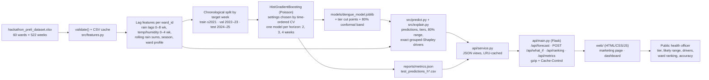

# Architecture

> ML sections (features, split, model selection) by A; data flow, serving, cost and Phase 2 by B/C.

## System data flow

Offline (once): data → features → training → serialized model and metrics. Online (per click):
the browser calls the local API, which reuses the loaded model and cached features. No step calls
an external service.

## Features and leakage control
Each forecast is made at origin week *t* for week *t + h*, where h = 2, 3 or 4, using only data up
to *t*. All features are computed per ward with `groupby("ward_id").shift(k)`:

- rainfall lags 0–8 weeks, including the 2–4 week breeding window (the 3-week lag correlates most
  with cases, r = 0.47);
- temperature and humidity lags;
- season (week-of-year);
- ward water-logging, density and sanitation.

Tests prove that no feature changes when future rows are removed. **Feature selection** dropped only
near-duplicates whose removal improved CV (the 4-week temperature mean, r = 0.98 with season); see
`reports/feature_selection_log.json` and `reports/feature_list.json`.

## Chronological validation split
| Set | Target weeks | Purpose |
|---|---|---|
| Train | 2016–2021 | fitting; **time-ordered CV**: 5 expanding yearly folds choose settings and features |
| Validation | 2022–2023 | confirming the choice; calibrating tiers and 80% intervals |
| Test | 2024–2025 | reported once, never used for any choice |

There is no random shuffle anywhere (sklearn's random early stopping is off).

## Model selection
12 models on identical folds (`reports/model_comparison.json`):

| Poisson deviance, CV mean (validation) | h=2 | h=3 | h=4 |
|---|---|---|---|
| Best baseline (seasonal mean / Ridge) | 1.91 (1.74) | 1.98 (1.96) | 1.98 (1.96) |
| Extra trees | 1.03 (0.98) | 1.16 (1.10) | 1.44 (1.57) |
| HistGradientBoosting, Poisson loss | 0.96 (1.03) | 1.14 (1.20) | 1.31 (1.70) |
| **Deployed (tuned / ensemble)** | **0.95 (0.97)** | **1.09 (1.11)** | **1.28 (1.58)** |

Random search (75 trials, `reports/tuning_log.json`) and single-change tests, under rules fixed in
advance, adopted: outbreak-week weighting (h=2 ×4; h=3 ×2 on a boosting + extra-trees average),
regularised settings at h=4 and season-aware ranges; recent-year weights and isotonic recalibration
were rejected (`reports/improvements_round2.json`). **Ensemble (Part H):** at h=2 a weighted average
(boosting 0.65, random forest 0.22, Poisson GLM 0.13; weights fitted on out-of-fold training
predictions) beat it by 2.2% on CV; stacking never helped (`reports/ensemble.json`). Recent case
counts didn't help, so the model stays weather-only.

**Test (2024–25):**
- MAE 1.12 / 1.12 / 1.25 (seasonal baseline 1.26).
- Truly Critical weeks flagged High or above: 88% / 78% / 68%; alert precision 0.49 (h=2).
- Outbreak weeks are still under-predicted by 5–8 cases (`reports/outbreak_errors.json`).

**Ablation** (`reports/ablation.json`): removing weather raises CV MAE by 39% / 26% / 4% (h=2/3/4);
removing ward attributes by 13% / 10% / 6%. **Ward ranking** (`reports/ranking_eval.json`): about half of
each in-season week's predicted top-10 wards are truly top-10 (test 0.51 / 0.49 / 0.48; random 0.17).

At h=4 the model barely beats the baseline, because the main driver (rain 3 weeks earlier) hasn't
fallen yet, so **2–3 weeks is the dependable window**. An unseen-city hold-out matches seen cities
(MAE 1.08 against 1.08 at h=2).

**Tiers:** 2 / 9 / 15 or more cases (training p70/p90/p97), calibrated on validation.
**Intervals:** conformal per prediction level and season (Jul–Oct coverage 0.77–0.78).
**Drivers:** exact grouped Shapley values, plus global importance and partial dependence (`reports/explainability.json`). The tier and interval issues
were first seen on test, then confirmed on validation. Test rows are hash-locked
(`reports/test_set_lock.json`), and a test fails if any decision script reads them.

## Serving, compute and API cost efficiency

- **No LLMs and no external APIs.** Inference runs locally from the serialized model, so there are no
  per-request fees, token costs or rate limits. `scripts/measure_efficiency.py` blocks outbound network
  while it exercises every endpoint and records `external_api_calls` (0) and `llm_calls` (0) in `reports/efficiency.json`.
- **Serialized model, loaded once.** `models/dengue_model.joblib` holds all three horizon models and is
  loaded at startup (`load_bundle()`, cached). Lag features for all wards are built once and reused.
- **Weather what-if (`POST /api/what_if`).** Typed weekly rain / temperature / humidity replace the last 1–8 weeks
  of the ward's recorded weather, then the same lag pipeline and model run (a test proves real values reproduce the
  baseline). Baselines always use recorded weather; inputs outside the training range return a warning.
- **Response caching.** Each API response depends only on its query, so `forecast` and `ranking` are
  memoised with bounded LRU caches. The responses carry `Cache-Control: max-age=3600`, so browsers and any
  CDN can reuse them.
- **Vectorised inference.** One `predict_all` call scores all 60 wards in a single model pass. The
  Shapley drivers need 32 batched calls for all 60 wards together, not separate calls per ward.
- **Small payloads.** JSON responses over 1 KB are gzip-compressed.
- **Minimal dependencies.** Python only (scikit-learn, pandas, Flask). There's no Node build or GPU,
  and it runs on a basic office laptop.

Measured with `python scripts/measure_efficiency.py --train --train-repeats 3` on a MacBook (Apple silicon, 8 cores,
Python 3.9.6, 21 Nov 2026, load average 5.12 at start); medians over 50 calls, retrain median of 3.
Source: `reports/efficiency.json`.

| Measure | Value |
|---|---|
| Model file size (3 horizon models, incl. 2-week ensemble) | 11.4 MB |
| Model load at startup (once) | 0.43 s |
| Lag features for all 60 wards × 522 weeks (once at startup, from the CSV cache; a fresh clone reads the Excel file once, which is slower) | 1.0 s |
| App startup, including pre-computing the default week | 2.7 s |
| One-ward forecast, uncached: median / 95th percentile of 50 calls | 0.76 s / 0.88 s |
| Ranking of 60 wards / one-ward forecast, cached (median of 50) | 0.002 s / 0.0006 s |
| What-if scenario (POST /api/what_if, 4 weeks replaced): new / repeated | 0.53 s / 0.016 s |
| Ranking payload, raw → gzip | 31.7 KB → 3.3 KB |
| Peak Python memory | 229 MB |
| Full retrain, 3 horizons with time-ordered CV: median (min–max of 3) | 100 s (97–106 s) |
| External API calls / LLM calls during the run | 0 / 0 |

## Path to a live system (Phase 2)

The split into model → `api/service.py` → `api/main.py` → `web/` keeps each layer replaceable:

- **Live data.** Append new weekly weather and case rows, re-run `validate()` and refresh the caches. The
  lag pipeline and API contract don't change.
- **Scale out.** The API is stateless, so several workers can run behind a load balancer (for example
  gunicorn), with the static `web/` folder on a CDN.
- **Retraining.** `python -m src.train` rebuilds every artifact in under 2 minutes (100 s median of 3 runs). Metrics are versioned next to
  the model in `reports/`.
