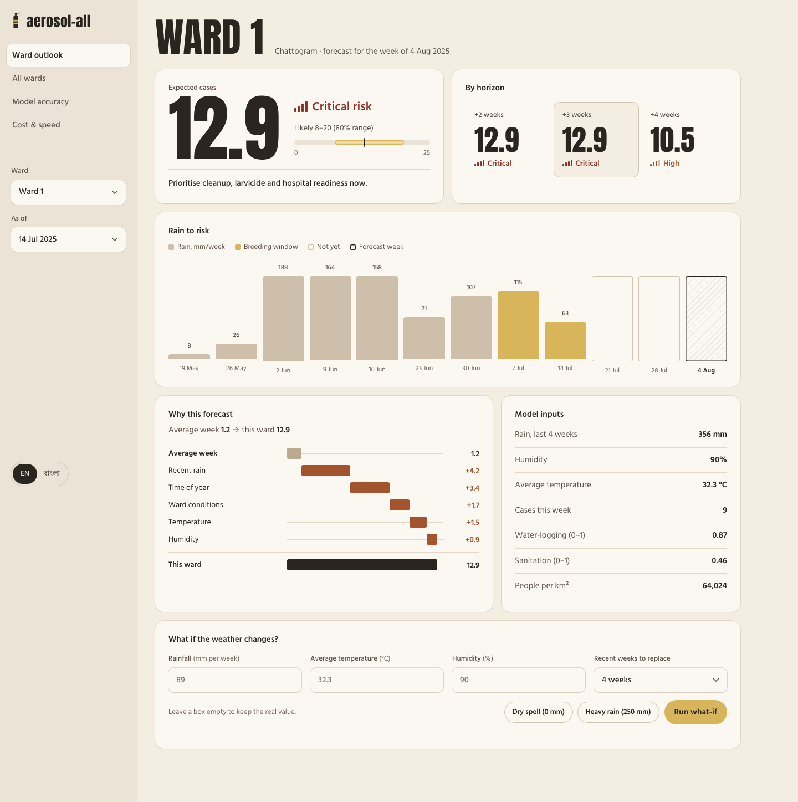
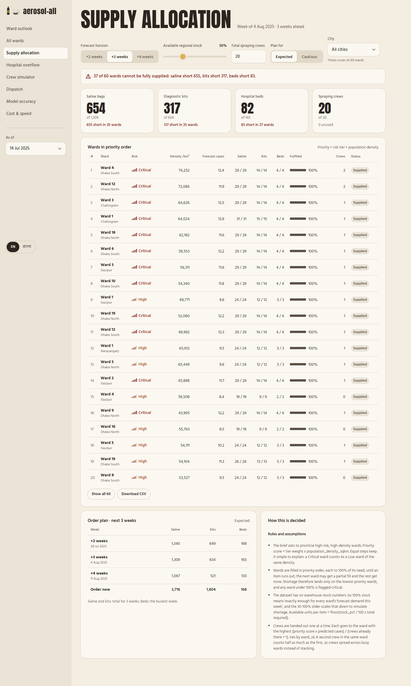
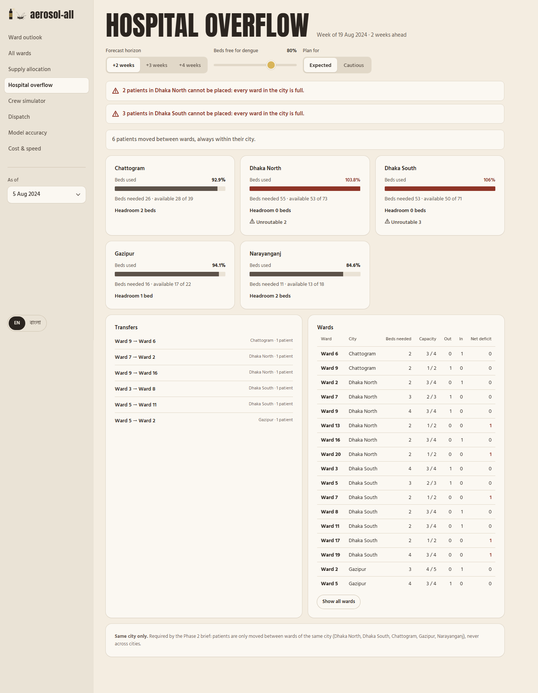
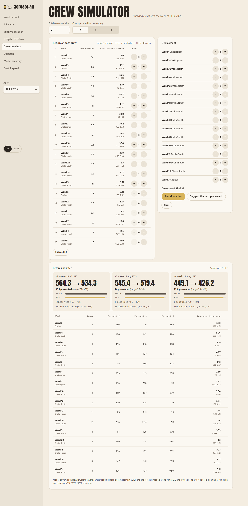
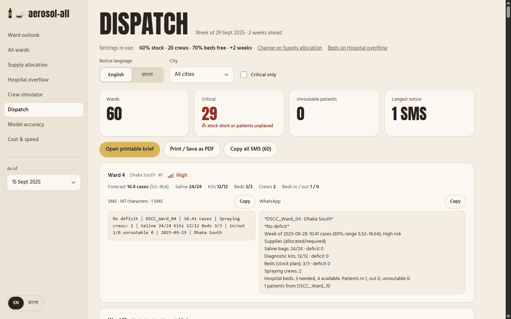

# Dengue Early-Warning for Urban Wards

Forecasts weekly dengue cases and a **risk tier (Low / Medium / High / Critical)** for 60 city
wards in Dhaka North, Dhaka South, Chattogram, Gazipur and Narayanganj, **2, 3 and 4 weeks ahead**.
It uses lagged rainfall, temperature and humidity, plus each ward's water-logging, density and
sanitation profile. Public health officers can use it to send larvicide teams and hospital
resources to high-risk wards before cases peak.

**Phase 2** turns the forecast into action: who gets saline, test kits, beds and spraying crews when stock is short,
where hospital overflow can go within each city, what sending crews would change 2–4 weeks later, and ready-to-send
SMS, WhatsApp and printable notices in English and বাংলা. Everything runs offline.

> Decision support on the provided hackathon dataset, not a medical diagnosis.

**Live demo: https://aerosol-all-1.onrender.com** (dashboard: `/app/`). It runs on Render's free plan, which sleeps
after 15 idle minutes: the first visit after that can take a couple of minutes to wake it. Everything also runs
locally and offline (below).

## Quick start (about 3 minutes)
```bash
git clone https://github.com/ameerul-muminin/aerosol-all.git
cd aerosol-all
python -m venv .venv
source .venv/bin/activate          # Windows: .venv\Scripts\activate
pip install -r requirements.txt
python -m api                      # open http://127.0.0.1:8000
```
Tested with Python 3.11, 3.12 and 3.13. **Python 3.14 is not supported** (no scikit-learn 1.6.1 build for it yet).
The trained model is committed, so no training is needed to launch.
One process serves the marketing page (`/`), the dashboard (`/app/`) and the JSON API (`/api/...`). No Node.js needed.
With Docker instead: `docker build -t aerosol . && docker run --rm -p 7860:7860 aerosol`, then open http://localhost:7860
(production server; hosting steps in [docs/DEPLOY.md](docs/DEPLOY.md)).
Try a weather scenario (typed weekly values replace the last 4 weeks, then the same lag pipeline runs):
`curl -X POST http://127.0.0.1:8000/api/what_if -H "Content-Type: application/json" -d '{"ward_id": "DSCC_Ward_04", "as_of": "2025-07-21", "horizon": 3, "rainfall_mm": 200}'`
→ baseline vs scenario forecast, tier change and drivers.
Inputs: `ward_id` (required), `as_of` (YYYY-MM-DD Monday), `horizon` (2/3/4), and at least one of `rainfall_mm` (0–400 per week),
`avg_temp_c` (10–45), `relative_humidity_pct` (0–100); `weeks` (1–8, default 4) = how many recent weeks the typed values replace.
The **baseline** uses the dataset's recorded weather; the **scenario** uses your typed weather. Values outside the
training range (rain above 268.8 mm, temperature outside 17.2–37.5 °C, humidity below 41.8 %) return a warning, because the
model cannot extrapolate beyond what it has seen.

## What is in the app
| Where | What you get |
|---|---|
| `/` landing page | Live counts of Critical/High wards, accuracy per horizon, and **Check a ward**: pick a ward and a week (latest in the data or any earlier one), optionally type that week's rain, temperature and humidity, and get the forecast, risk tier, likely range and top reasons |
| `/app/#outlook` Ward outlook | Expected cases, risk tier (colour + glyph + word), 80% likely range, rain-to-risk timeline, **"Why this forecast"** driver breakdown, and a what-if weather panel |
| `/app/#wards` All wards | **Early warnings** (wards getting worse over the next 4 weeks), tier counts, ranking with a ward × horizon heat strip, by-city bars, CSV download |
| `/app/#accuracy` Model accuracy | Test-year MAE/RMSE vs the seasonal average per horizon and per city, one ward's forecast vs reported cases with the 80% band, and the **breeding clock**: rain 0–12 weeks earlier vs cases now |
| `/app/#cost` Cost & speed | Model size, cached vs fresh response times, response size, and live counters of how much work the caches save |
| `/app/#allocation` Supply allocation | **Live scarcity controls**: available stock slider (30–100%), total spraying crews, expected or cautious demand, city. A red deficit alert, tiles for saline, kits, beds and crews, and every ward's allocated vs required supplies, crews and critical flag in priority order (CSV). Plus the order plan for weeks +2 to +4 |
| `/app/#overflow` Hospital overflow | Slider for the share of beds free for dengue; each city's bed use, headroom and patients who cannot be placed; transfers (always inside one city); each ward's net deficit |
| `/app/#simulator` Crew simulator | Wards ranked by cases prevented per crew (with a low–high band); pick wards and crews, re-run the models and see cases, beds and saline before and after at +2, +3 and +4 weeks; suggest the best placement |
| `/app/#dispatch` Dispatch | Each ward's SMS and WhatsApp notice in English or বাংলা with copy buttons, a critical-only filter, and the printable commissioner brief (print or save as PDF) |

Every view works in English and বাংলা. Screenshots: [docs/screenshots/](docs/screenshots/README.md)

| | | |
|---|---|---|
|  |  |  |
|  |  |  |

| Phase 2 | |
|---|---|
|  |  |
|  |  |

## Phase 2: from forecast to action
Forecast cases become saline bags, test kits and hospital beds through the dataset's own fixed table
(`src/supplies.py`). Four planners use them. Anything the data does not contain (stock, bed capacity, number of
crews, effect of a crew) is a stated assumption in [`config/operations.json`](config/operations.json), with its
reason next to it, and every Phase 2 planning answer from the API includes the assumptions it used.

| Module | Question it answers |
|---|---|
| **Allocation** (`src/allocation.py`) | Stock is only 30–100% of what is needed and crews are limited: who gets what? Highest risk × population density first; any ward left short is flagged `critical`. |
| **Overflow routing** (`src/overflow.py`) | Which wards will need more beds than they have, and where can those patients go? Only to wards with free beds **in the same city**; patients who cannot be placed are reported, not hidden. |
| **Crew simulator** (`src/intervention.py`, `src/placement.py`) | If crews go to these wards, how much do cases, beds and saline drop 2–4 weeks later? The real models are re-run on the changed inputs. Wards are ranked by cases prevented per crew, and the best placement is found for a given number of crews. |
| **Dispatch** (`src/dispatch.py`) | Ready-to-send SMS, WhatsApp text and a printable brief per ward, in English and বাংলা, from fixed templates (no LLM). |
| **Order plan** (bonus) | What to order now for weeks +2, +3 and +4: saline, kits and beds per ward, city and region, for the expected forecast and the cautious top of its range. |

Try them with the server running (`python -m api`):
```bash
curl -X POST http://127.0.0.1:8000/api/allocate -H "Content-Type: application/json" \
     -d '{"as_of": "2025-07-14", "horizon": 3, "stock_pct": 60, "crews": 20}'
curl "http://127.0.0.1:8000/api/overflow?as_of=2025-09-15&horizon=2&beds_available_pct=70"
curl -X POST http://127.0.0.1:8000/api/intervention -H "Content-Type: application/json" \
     -d '{"as_of": "2025-07-14", "deployment": {"DSCC_Ward_04": 2, "CCC_Ward_01": 1}}'
curl "http://127.0.0.1:8000/api/intervention/roi?as_of=2025-07-14"
curl "http://127.0.0.1:8000/api/crew_plan?as_of=2025-07-14&crews=20"
curl "http://127.0.0.1:8000/api/dispatch?as_of=2025-09-15&horizon=2&stock_pct=60&crews=20&beds_available_pct=70&lang=bn"
curl "http://127.0.0.1:8000/api/supply_plan?as_of=2025-07-14"
```
Rules, reasons and limits of each module: [ARCHITECTURE.md](ARCHITECTURE.md#phase-2-from-forecast-to-action).

## Works offline
Nothing at runtime needs the internet: the model and both data files are committed, fonts, images, CSS and JS are
in `web/assets/` (no CDN), charts are hand-built, and no code calls an external API or an LLM. Two ways to check:
```bash
python -m scripts.offline_check   # blocks the network, starts the app, calls every /api route, loads every file
                                  # the pages use, and scans web/ and the Python code for network use
curl "http://127.0.0.1:8000/api/selfcheck"   # re-runs the Phase 2 math live and reports each check
```
Or turn Wi-Fi off, run `python -m api` and use every view.

## Exports
[`exports/`](exports/README.md) holds sample notices for the week of 2025-09-15, 2 weeks ahead, with 60% stock,
20 crews and 70% of beds free for dengue: `sms_2025-09-15.txt`, `whatsapp_2025-09-15.txt`, and printable briefs
`brief_2025-09-15_en.html` / `brief_2025-09-15_bn.html` (critical wards first). To rebuild them:
```bash
python -m scripts.export_dispatch --as-of 2025-09-15 --horizon 2 --stock-pct 60 --crews 20 --beds-pct 70
```

## Retrain and re-check (one command each)
```bash
python -m src.train      # rebuilds models/dengue_model.joblib and reports/metrics.json (about 2 min)
python scripts/measure_efficiency.py --train --train-repeats 3   # re-measures speed, memory, model size and retrain time -> reports/efficiency.json (the model is restored afterwards)
python -m scripts.phase2_numbers   # prints every Phase 2 number quoted in ARCHITECTURE.md (read-only, about a minute)
python -m pytest -q      # lag pipeline, leakage, model, Phase 2, API and offline tests
```

## Project structure
```
api/                       JSON API + static web server (Flask)
web/                       marketing page and dashboard (HTML/CSS/JS)
src/features.py            data validation + per-ward lag features
src/train.py               chronological split, model selection, tiers, conformal intervals
src/predict.py             model inference (predict_risk / predict_all)
src/supplies.py            cases -> saline, kits, beds (the dataset's own table)
src/allocation.py          supplies and crews under shortage
src/overflow.py            hospital bed overflow, routed within each city
src/intervention.py        crew simulator (re-runs the models) and ROI ranking
src/placement.py           best crew placement
src/dispatch.py            SMS, WhatsApp and printable notices (EN + বাংলা)
src/selfcheck.py           live checks of the Phase 2 math
config/operations.json     Phase 2 assumptions (stock, beds, crews, crew effect), each with its reason
models/dengue_model.joblib serialized models (one per horizon)
reports/metrics.json       validation and test metrics
scripts/                   offline check, dispatch export, efficiency and Phase 2 number scripts
exports/                   sample dispatch notices
tests/                     pytest suite
ARCHITECTURE.md            data flow, validation split, model rationale, efficiency, Phase 2 design
Dockerfile, docs/DEPLOY.md container and hosting guide
docs/frontend/             frontend guide for the web/ build
```

## Dataset
Both files were provided by the organizers: 31,320 weekly rows for 60 wards, 2016-01-04 to 2025-12-29.
`bangladesh_dengue_large_dataset_onsite.xlsx` (Phase 2, used by default) has the same rows and columns as the Phase 1
file `hackathon_preli_dataset.xlsx`, plus three supply columns: saline bags, diagnostic kits and hospital beds needed.
Those columns are used for planning only, never as model inputs, so the Phase 1 model and results are unchanged.
On first load the data is validated and cached as `data/dataset_cache.csv`.

**Ward map** (`/proto/map.html`): ward boundaries from the Bangladesh Bureau of Statistics and OCHA ROAP, via
[geoBoundaries](https://www.geoboundaries.org) (CC BY 3.0 IGO), simplified into `web/assets/data/ward_map.json`
by `python -m scripts.build_ward_map ADM2.geojson ADM3.geojson ADM4.geojson` (reads local files only). The dataset gives
ward IDs, not locations, so placing each ID on a real ward is an assumption, written in the script and on the map page.
Gazipur and Narayanganj have no published ward boundaries, so only their city area is drawn.

## Results
Test years 2024–2025, never used for training or model choice (read from `reports/metrics.json`; cases per ward-week):

| Horizon | Deployed model | MAE | Seasonal-average MAE | RMSE | Seasonal-average RMSE | Inside the 80% range |
|---|---|---|---|---|---|---|
| 2 weeks | weighted ensemble (boosted trees, random forest, Poisson GLM) | 1.12 | 1.26 | 2.23 | 2.53 | 78.5% |
| 3 weeks | blend of boosted trees + extra trees | 1.12 | 1.26 | 2.19 | 2.53 | 78.4% |
| 4 weeks | gradient-boosted trees (Poisson), with city-wide case rates | 1.24 | 1.26 | 2.45 | 2.53 | 78.5% |

At 4 weeks the model is only slightly better than the seasonal average on MAE: forecasting further ahead is harder.
In the data, rain that is above normal for the time of year is followed by above-normal cases about 3 weeks later
(`/api/lag_profile`), inside the 2–4 week breeding window from the brief. See `ARCHITECTURE.md` for the split and model choice.
Every number shown in the app is read from `reports/metrics.json` or `reports/efficiency.json`.

## API
`GET /api/meta` · `/api/forecast?ward_id&as_of&horizon` · `/api/ranking?as_of&horizon[&city]` · `/api/warnings?as_of[&city]` ·
`/api/metrics` · `/api/history?ward_id&horizon` · `/api/lag_profile[?city]` · `/api/efficiency` · `/api/health` · `POST /api/what_if`.
Phase 2: `POST /api/allocate` · `/api/overflow?as_of&horizon[&demand_basis&beds_available_pct]` · `POST /api/intervention` ·
`/api/intervention/roi?as_of[&crews_per_ward]` · `/api/crew_plan?as_of[&crews]` · `/api/selfcheck[?as_of&horizon]` ·
`/api/dispatch?as_of&horizon&stock_pct[&crews&beds_available_pct&lang&city]` · `/api/dispatch/brief` (same query; printable HTML) ·
`/api/supply_plan?as_of[&city]`.
Bad input returns HTTP 400 with `{"error": "<plain message>"}`.

## Commit history
Commit messages use `type(scope): summary`. In Phase 1 (21–22 Nov), 30 commits made in Claude Code sessions recorded
"Claude" as their git author; each was pushed by the team member running that session. In the onsite final
(27 Nov 2026) commits come from each member's own git identity and, once the convention was clarified, start with
`version-onsite-final:` as the Phase 2 brief asks. Earlier commits were left as they are, because rewriting shared
history would break every clone.

## AI Assistants and External APIs
| Tool | Used by | What for |
|---|---|---|
| Claude (claude.ai chat) | Alif | Planning, dataset profiling, code review of the ML pipeline, API layer, tests, README/ARCHITECTURE drafts, frontend brief and UI prototype |
| Claude Code | Alif, Nazifa, Srijita | Writing, refactoring and testing code in the repo under each member's direction. Alif in Phase 2: the Phase 2 API routes and their tests, offline and fuzz checks, merge-conflict fixes, README and ARCHITECTURE sections |
| Codex | Nazifa | Writing and testing code for the ML pipeline and the Phase 2 modules, under her direction |
| Grok | Nazifa | Research and questions: looking things up, explaining concepts, checking ideas |
| Antigravity (Gemini Pro, Hydrogen) | Srijita | Building the web frontend (`web/`) under her direction |

**External APIs at runtime: none.** The app calls only its own local `/api` endpoints. All inference runs
locally from the serialized model, so there are no API calls, tokens or usage costs.

## Team
- **Nazifa Jahan Neloy**: ML pipeline, model, validation and drivers
- **Alif**: repository, API, reproducibility and efficiency
- **Srijita Das**: frontend (dashboard and marketing page) and design
