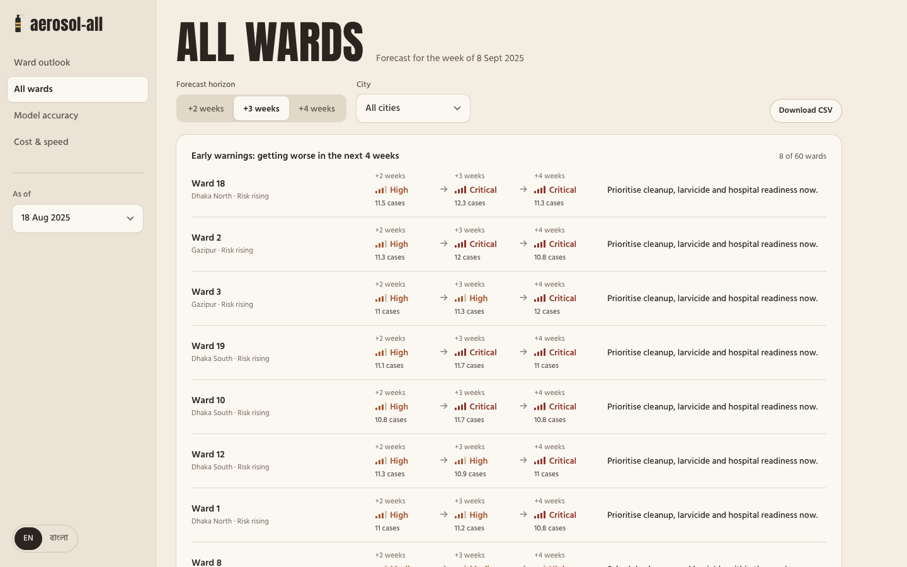
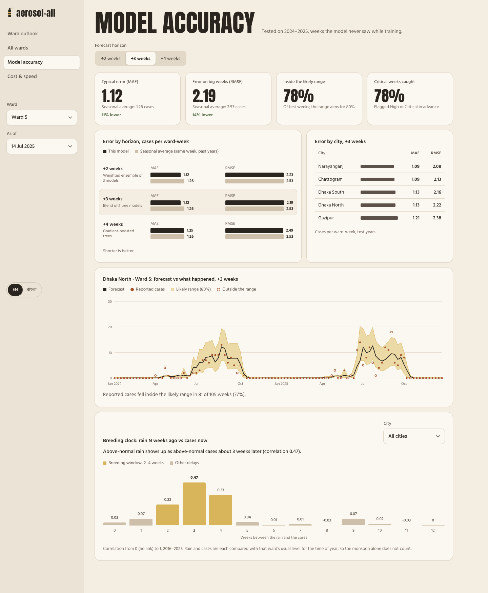
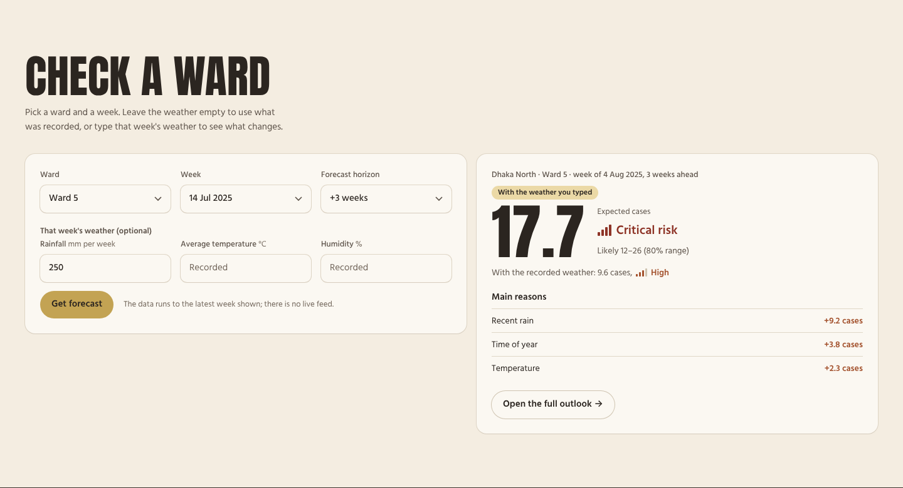
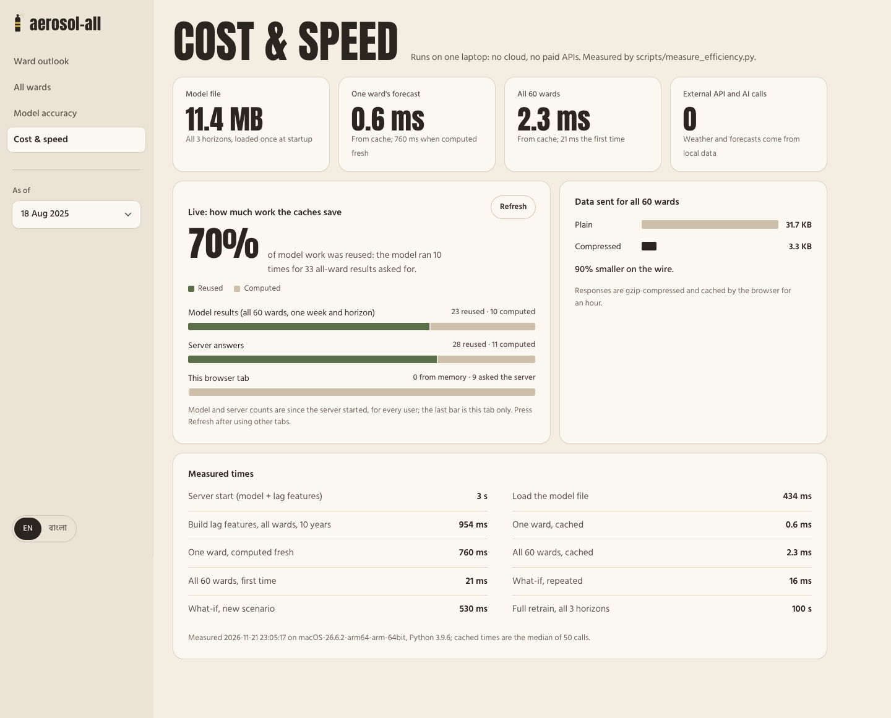
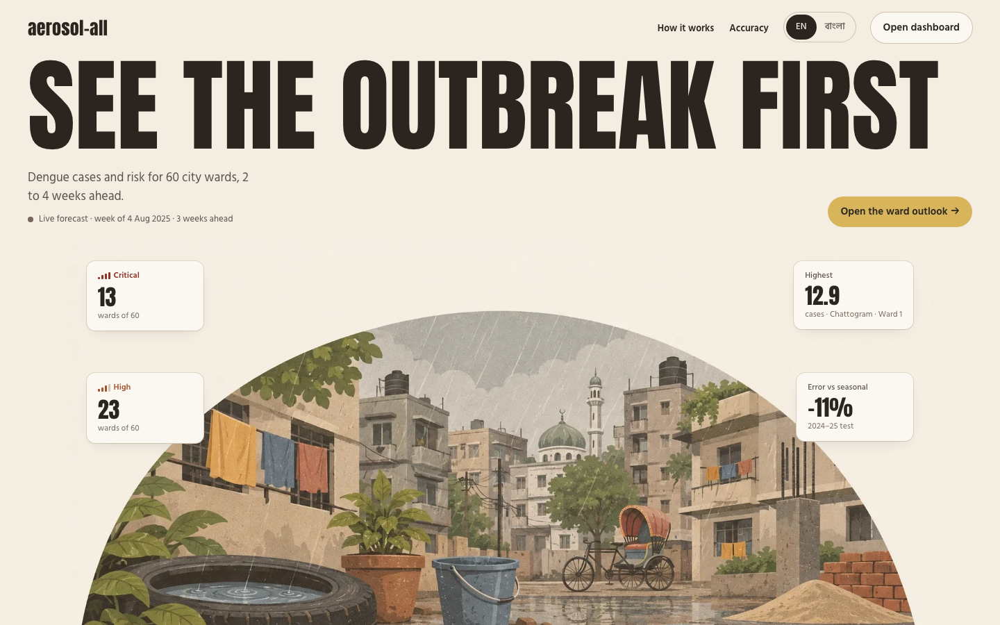

# Dengue Early-Warning for Urban Wards

Forecasts weekly dengue cases and a **risk tier (Low / Medium / High / Critical)** for 60 city
wards in Dhaka North, Dhaka South, Chattogram, Gazipur and Narayanganj, **2, 3 and 4 weeks ahead**.
It uses lagged rainfall, temperature and humidity, plus each ward's water-logging, density and
sanitation profile. Public health officers can use it to send larvicide teams and hospital
resources to high-risk wards before cases peak.

> Decision support on the provided hackathon dataset, not a medical diagnosis.

## Quick start (about 3 minutes)
```bash
git clone https://github.com/ameerul-muminin/aerosol-all.git
cd aerosol-all
python -m venv .venv
source .venv/bin/activate          # Windows: .venv\Scripts\activate
pip install -r requirements.txt
python -m api                      # open http://127.0.0.1:8000
```
Tested with Python 3.11, 3.12 and 3.13. **Python 3.14 is not supported** (no scikit-learn 1.6.1 build for it yet).
The trained model is committed, so no training is needed to launch.
One process serves the marketing page (`/`), the dashboard (`/app/`) and the JSON API (`/api/...`). No Node.js needed.
Try a weather scenario (typed weekly values replace the last 4 weeks, then the same lag pipeline runs):
`curl -X POST http://127.0.0.1:8000/api/what_if -H "Content-Type: application/json" -d '{"ward_id": "DSCC_Ward_04", "as_of": "2025-07-21", "horizon": 3, "rainfall_mm": 200}'`
→ baseline vs scenario forecast, tier change and drivers.
Inputs: `ward_id` (required), `as_of` (YYYY-MM-DD Monday), `horizon` (2/3/4), and at least one of `rainfall_mm` (0–400 per week),
`avg_temp_c` (10–45), `relative_humidity_pct` (0–100); `weeks` (1–8, default 4) = how many recent weeks the typed values replace.
The **baseline** uses the dataset's recorded weather; the **scenario** uses your typed weather. Values outside the
training range (rain above 268.8 mm, temperature outside 17.2–37.5 °C, humidity below 41.8 %) return a warning, because the
model cannot extrapolate beyond what it has seen.

## What is in the app
| Where | What you get |
|---|---|
| `/` landing page | Live counts of Critical/High wards, accuracy per horizon, and **Check a ward**: pick a ward and a week (latest in the data or any earlier one), optionally type that week's rain, temperature and humidity, and get the forecast, risk tier, likely range and top reasons |
| `/app/#outlook` Ward outlook | Expected cases, risk tier (colour + glyph + word), 80% likely range, rain-to-risk timeline, **"Why this forecast"** driver breakdown, and a what-if weather panel |
| `/app/#wards` All wards | **Early warnings** (wards getting worse over the next 4 weeks), tier counts, ranking with a ward × horizon heat strip, by-city bars, CSV download |
| `/app/#accuracy` Model accuracy | Test-year MAE/RMSE vs the seasonal average per horizon and per city, one ward's forecast vs reported cases with the 80% band, and the **breeding clock**: rain 0–12 weeks earlier vs cases now |
| `/app/#cost` Cost & speed | Model size, cached vs fresh response times, response size, and live counters of how much work the caches save |

Every view works in English and বাংলা. Screenshots: [docs/screenshots/](docs/screenshots/README.md)

| | | |
|---|---|---|
|  |  |  |
|  |  |  |

## Retrain (one command)
```bash
python -m src.train      # rebuilds models/dengue_model.joblib and reports/metrics.json (about 2 min)
python scripts/measure_efficiency.py --train --train-repeats 3   # re-measures speed, memory, model size and retrain time -> reports/efficiency.json (the model is restored afterwards)
python -m pytest -q      # lag pipeline, leakage, model and API tests
```

## Project structure
```
api/                       JSON API + static web server (Flask)
web/                       marketing page and dashboard (HTML/CSS/JS)
src/features.py            data validation + per-ward lag features
src/train.py               chronological split, model selection, tiers, conformal intervals
src/predict.py             model inference (predict_risk / predict_all)
models/dengue_model.joblib serialized models (one per horizon)
reports/metrics.json       validation and test metrics
tests/                     pytest suite
ARCHITECTURE.md            data flow, validation split, model rationale, efficiency
docs/frontend/             frontend guide for the web/ build
```

## Dataset
`hackathon_preli_dataset.xlsx` (provided by the organizers): 31,320 weekly rows for 60 wards,
2016-01-04 to 2025-12-29. On first load it is validated and cached as `data/dataset_cache.csv`.

## Results
Test years 2024–2025, never used for training or model choice (read from `reports/metrics.json`; cases per ward-week):

| Horizon | Deployed model | MAE | Seasonal-average MAE | RMSE | Seasonal-average RMSE | Inside the 80% range |
|---|---|---|---|---|---|---|
| 2 weeks | weighted ensemble (boosted trees, random forest, Poisson GLM) | 1.12 | 1.26 | 2.23 | 2.53 | 78.5% |
| 3 weeks | blend of boosted trees + extra trees | 1.12 | 1.26 | 2.19 | 2.53 | 78.4% |
| 4 weeks | gradient-boosted trees (Poisson) | 1.25 | 1.26 | 2.49 | 2.53 | 78.5% |

At 4 weeks the model is only slightly better than the seasonal average on MAE: forecasting further ahead is harder.
In the data, rain that is above normal for the time of year is followed by above-normal cases about 3 weeks later
(`/api/lag_profile`), inside the 2–4 week breeding window from the brief. See `ARCHITECTURE.md` for the split and model choice.
Every number shown in the app is read from `reports/metrics.json` or `reports/efficiency.json`.

## API
`GET /api/meta` · `/api/forecast?ward_id&as_of&horizon` · `/api/ranking?as_of&horizon[&city]` · `/api/warnings?as_of[&city]` ·
`/api/metrics` · `/api/history?ward_id&horizon` · `/api/lag_profile[?city]` · `/api/efficiency` · `/api/health` · `POST /api/what_if`.
Bad input returns HTTP 400 with `{"error": "<plain message>"}`.

## AI Assistants and External APIs
| Tool | Used by | What for |
|---|---|---|
| Claude (claude.ai chat) | Alif | Planning, dataset profiling, code review of the ML pipeline, API layer, tests, README/ARCHITECTURE drafts, frontend brief and UI prototype |
| Claude Code | Alif, Nazifa | Writing, refactoring and testing code in the repo under each member's direction |
| Antigravity | Srijita | Building the web frontend (`web/`) under her direction |

**External APIs at runtime: none.** The app calls only its own local `/api` endpoints. All inference runs
locally from the serialized model, so there are no API calls, tokens or usage costs.

## Team
- **Nazifa Jahan Neloy**: ML pipeline, model, validation and drivers
- **Alif**: repository, API, reproducibility and efficiency
- **Srijita Das**: frontend (dashboard and marketing page) and design
